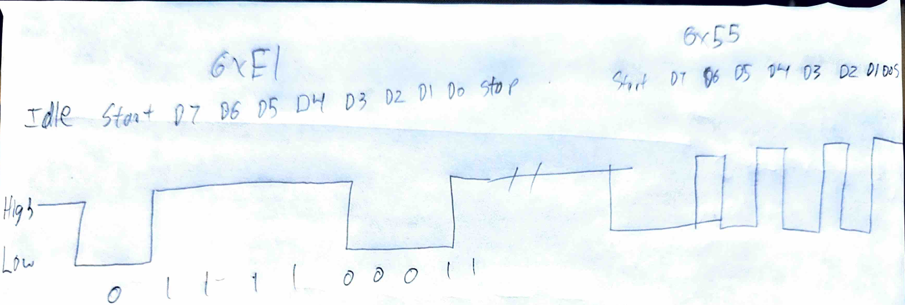
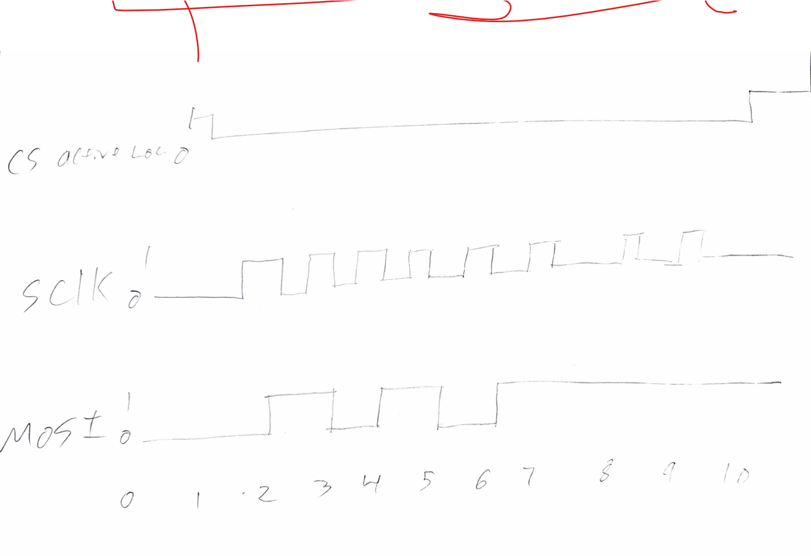

# ECE 528/L — Homework 3

## 1. (10 pts)

The MSP432 uses the eUSCI_A modules for UART communication. Describe the function of the following registers:

- UCAxBRW (Baud Rate Control Word): Sets the clock divider used to generate the UART baud rate.

- UCAxMCTLW (Modulation Control Word): Controls the baud-rate modulation for fractional timing adjustments and enables or disables sampling.

- UCAxCTLW0 (Control Word 0): Configures the UART settings, including clock source, parity, data length, stop bits, bit order, and software reset.

- UCAxRXBUF (Receive Buffer): Holds the received character for the programs to read.

- UCAxTXBUF (Transmit Buffer): Holds the character written by the program while it waits to be transmitted

## 2. (5 pts)

What is the purpose of the UCAxSTATW status register in the UART module? Which bits indicate the following?

It reports UART activity and receives errors

- Whether the UART module is currently transmitting
UCBUSY, bit 0 indicates transmitting or receiving

- Whether a framing, parity, or overrun error has occurred
UCFE is bit 6 for framing, UCPE is bit 4 for parity, and UCOE is bit 5 for overrun
- Whether the RX buffer contains unread data
UCRXIFG is bit 0 and it is set when received data is ready to be read.


## 3. (5 pts)

Assume that the eUSCI_A3 module is using SMCLK as its clock source, which has a frequency of 12 MHz. Calculate the value that is needed to be written to the UCAxBRW register to configure the eUSCI_A3 module for 115200 baud.

12,000,000 / 115,200 = 104.1667
104.1667 / 16 = 6.5104 = 6
0x0006 to EUSCI_A3->BRW is what needs to be written to enable 115200 baud rate communication.

## 4. (a) (15 pts)

Write a function named UART2_Init that configures the eUSCI_A2 module for the following settings:

- Baud Rate: 115200
- Data Length: 8 bits
- Parity: None
- Stop Bits: 1
- Bit Order Most Significant Bit (MSB) First
- Clock Source: SMCLK (12 MHz)
- Pins: P3.2 (UCA2TXD) and P3.3 (UCA2RXD)
```c
void UART2_Init(void)
{
    // Hold eUSCI_A2 in software reset.
    EUSCI_A2->CTLW0 |= 0x0001;
    P3->SEL0 |= 0x0C;
    P3->SEL1 &= ~(0x0C0);
    // SMCLK, MSB first, 8-bit data, no parity,
    // one stop bit, UART mode, reset held.
    EUSCI_A2->CTLW0 = 0x2081;
    // 12 MHz SMCLK, 115200 baud, 16x oversampling.
    EUSCI_A2->BRW = 0x0006;
    EUSCI_A2->MCTLW = 0x2081;
    EUSCI_A2->IE = 0x0000;
    EUSCI_A2->CTLW0 &= ~(0x0001);
}
```
### (b) (10 pts)

Suppose that you have a main program that is transmitting data using the eUSCI_A2 module given the configuration in part (a). Draw the waveform for the UART TX data line if the main program is transmitting two bytes: 0xF1 followed by 0x55. Clearly label the start bits, data bits, and stop bits. Assume that there is a 50 ms delay between the two bytes.



## 5. (5 pts)

What is the function of the eUSCI_B module? How does SPI communication differ from UART communication in terms of:

- Synchronization
SPI shares a clock and UART agrees on a baud rate.

- Clocking
The master supplies SCLK for SPI and UART has no seperate clock.

- Signaling
Uses SCLK, MOSI, MISO, and CS for SPI while UART uses TX and RX

- Data Framing
CS marks the transaction with no start or stop bits. UART has a start bit, data bits, optional parity, and stop bits.

## 6. (a) (5 pts)

Explain the role of the following SPI signals:

- SCLK: The master generates this clock to synchronize data bits during SPI communication
- CS: Selects the peripheral that will communicate with the master in either active high or active low.
- MISO: Carries data from the slave to the master.
- MOSI: Carries data from the master to the slave.

### (b) (5 pts)

What happens if multiple SPI peripheral devices have their CS line asserted simultaneously on the MSP432?

It can give corrupted data due to bus contention.

## 7. (a) (5 pts)

Briefly describe the function of the UCBxCTLW0 (Control Word 0) register from the eUSCI_B module.

UCBxCTLW0 configures the eUSCI_B module's communication settings, including SPI clock polarity and phase, bit order, data length, clock source, and softwarer reset.

### (b) (5 pts)

Which bits need to be cleared or set in the UCBxCTLW0 register to configure the SPI mode used by the eUSCI_B module? Provide a description of each bit.

USYNC is bit 8 (0x0100) and is used to enable synchronous communication 

UCMODE, bits 9-10 (0x0600) clears both for 3 wire SPI. 01 selects 4 wire SPI with active high STE, and 10 selects 4 wire SPI with active low STE.

UCCKPL is bit 14 (0x4000) clears for a clock that idles low; set for a clock that idles high.

UCCKPH is bit 15 (0x8000) sets capture data on teh first clock edge; clear to capture on second edge.

UCMST is bit 11 (0x0800) sets for master operation; clear for slave operation.

### (c) (5 pts)

Which field in the UCBxCTLW0 register selects the clock source used by the eUSCI_B module? Provide the values used and the corresponding clock sources.

Bit 7 and 6 need to be cleared in UCBxCTW0, selects the clock source for SPI.

00 0x0000 Reserved clock source
01 0x0040 ACLK clock source
10 0x0080 SMCLK clock source
11 0x00C0 SMCLK clock source

## 8. (a) (15 pts)

Write a function named EUSCI_B0_SPI_Init that configures the eUSCI_B0 module for SPI communication with the following settings:

- SPI Mode: 0
- Data Length: 8 bits
- Bit Order: Most Significant Bit (MSB) First
- Clock Source: SMCLK (12 MHz)
- SPI Clock Frequency: 1 MHz
- SPI format: 3-wire SPI
- SPI Pins:
  - P1.5: SCLK (UCB0CLK)
  - P1.6: MOSI (UCB0SIMO)
  - P1.7: MISO (UCB0SOMI)
  - P9.0: Active Low Chip Select (GPIO)
```c
#include "msp.h"

void EUSCI_B0_SPI_Init(void)
{
    EUSCI_B0->CTLW0 |= 0x0001;
    P1->SEL0 |= 0xE0;
    P1->SEL1 &= ~0xE0;
    P9->SEL0 &= ~0x01;
    P9->SEL1 &= ~0x01;
    P9->OUT |= 0x01;
    P9->DIR |= 0x01;

    // Mode 0: UCCKPH = 1, UCCKPL = 0.
    // Master, MSB first, 8-bit data, 3-wire SPI,
    // SMCLK selected, software reset held.
    EUSCI_B0->CTLW0 = 0xA981;
    EUSCI_B0->BRW = 0x000C;
    // Disable interrupts for polling.
    EUSCI_B0->IE = 0x0000;

    EUSCI_B0->CTLW0 &= ~0x0001;
}
```

### (b) (10 pts)

If a main program transmits one byte with a value of 0x57, draw the waveforms for:

- Chip Select (Active Low)
- SCLK
- MOSI

